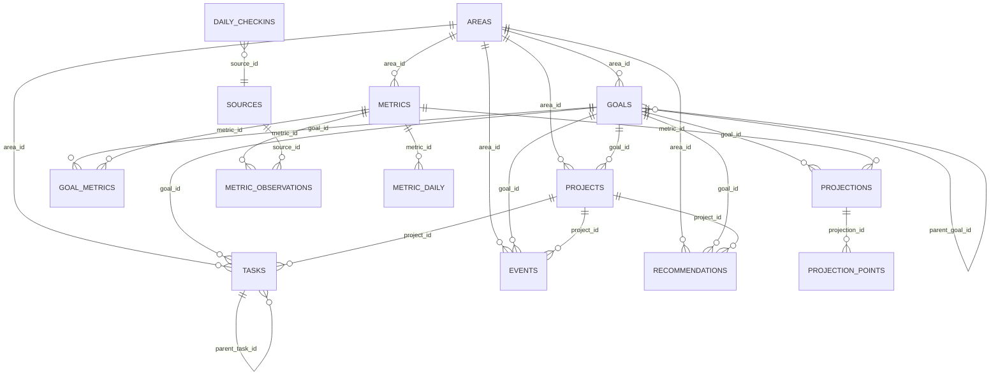
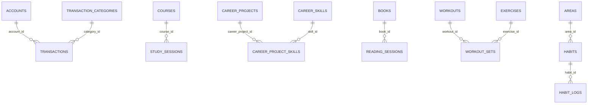

# Modelo de Dados — Personal OS

- **Versão:** 1.0 (Fase 0)
- **Data:** 2026-11-20
- **Status:** Aprovado; fundação implementada na Entrega 2, fluxos de autenticação na Entrega 3 e modelo central/Estudos na Entrega 5 da Tarefa 1.2 (aguardando revisão). Ajustes locais da Entrega 5 em [ADR-0013](decisions/0013-modelo-central-estudos.md)
- **Banco:** Cloudflare D1 (SQLite 3)
- **ORM:** Drizzle ORM

Este documento define entidades, relacionamentos, chaves, índices, restrições, campos temporais, proveniência e auditoria. A implementação deve seguir este documento; divergências exigem atualização prévia e, quando estruturais, um ADR.

---

## 1. Convenções

### 1.1 Identificadores

- `id TEXT PRIMARY KEY` com **UUIDv7** (RFC 9562), gerado na aplicação. Ordenável por tempo, reduz fragmentação de índice e evita dependência de extensão.
- Chaves naturais (`key`, `isbn13`, `external_ref`) são `UNIQUE` quando fizer sentido, mas nunca substituem a PK.
- Tabelas de junção usam chave composta.

### 1.2 Nomes

- Banco: `snake_case`, plural (`metric_observations`).
- API: `camelCase` (`metricObservations`), mapeado na borda.
- Enums: `TEXT` + `CHECK (col IN (...))`. SQLite não tem enum nativo; lookup tables só quando o conjunto for editável pelo usuário (ex.: `areas`).

### 1.3 Colunas comuns

Salvo indicação contrária, entidades de domínio incluem:

| Coluna | Tipo | Regra |
| --- | --- | --- |
| `id` | `TEXT` | PK, UUIDv7 |
| `created_at` | `TEXT` | UTC ISO-8601 com ms, imutável |
| `updated_at` | `TEXT` | UTC ISO-8601 com ms, atualizado em toda escrita |
| `deleted_at` | `TEXT NULL` | Soft delete; `NULL` = ativo |
| `version` | `INTEGER` | `NOT NULL DEFAULT 1`; concorrência otimista |
| `source_id` | `TEXT` | FK `sources(id)`, `NOT NULL`; proveniência |
| `metadata_json` | `TEXT NULL` | JSON validado, limite 16 KB |

Tabelas de fatos/observações (`transactions`, `metric_observations`, `study_sessions`, `reading_sessions`, `workouts`, `wellbeing_records`, `habit_logs`) não têm sobrescrita silenciosa: toda correção é auditada. Em `metric_observations` e `transactions`, o valor anterior é preservado explicitamente (`superseded_by`/`void` + novo registro).

### 1.4 Tempo

- Instantes: `TEXT` UTC ISO-8601 com milissegundos (`2026-11-20T18:30:00.000Z`).
- Dias: `local_date TEXT` no formato `YYYY-MM-DD`, calculado no fuso do usuário (`users.timezone`).
- **Ajuste da Entrega 5 (ADR-0013):** `timezone` IANA passa a ser capturado por registro nas entidades de fato implementadas (`study_sessions`, `metric_observations`, `events`), preservando o fuso vigente no momento do fato. A mudança de fuso da conta não reescreve `local_date` históricos. A regra original ("`timezone` nunca é armazenado por registro na v1") fica revogada apenas para essas entidades; as demais continuam sem o campo.
- Campos de data sem hora (`target_date`, `started_on`) usam `YYYY-MM-DD`.
- Defaults SQL: `strftime('%Y-%m-%dT%H:%M:%fZ','now')`. Não usar `CURRENT_TIMESTAMP` (formato sem ms e com espaço).

### 1.5 Dinheiro

- `INTEGER` em **centavos** (`amount_cents`, `opening_balance_cents`, `weight_g` em gramas).
- `currency TEXT` com ISO-4217 (`BRL`).
- Nunca `REAL` para saldo. Percentuais e estatísticas podem usar `REAL`, sempre derivados.

### 1.6 Proveniência

`source_id` é obrigatório em toda entidade de fato. Fontes de sistema são semeadas com IDs fixos:

| ID | Kind | Uso |
| --- | --- | --- |
| `src_manual` | `manual` | Entrada do usuário |
| `src_import` | `import` | CSV/JSON importado |
| `src_calculation` | `calculation` | Derivado por algoritmo determinístico |
| `src_inference` | `inference` | Inferência/estimativa (exige `confidence`) |
| `src_integration_*` | `integration` | Criada sob demanda por integração |

Os quatro IDs fixos acima são a exceção documentada à regra de UUIDv7: são chaves de sistema estáveis, semeadas por `packages/db/src/seed.sql`. Todas as demais entidades de domínio usam UUIDv7.

Campos complementares:

- `source_ref TEXT NULL`: identificador na origem (ex.: ID externo).
- `dedupe_key TEXT NULL UNIQUE`: chave idempotente para importações/integrações. Ex.: `bank:acct:2026-11-20:hash`.
- `confidence REAL NULL CHECK (confidence BETWEEN 0 AND 1)`: obrigatório quando `source.kind = 'inference'`.
- `algorithm_version TEXT NULL`: obrigatório quando `source.kind = 'calculation'`.

### 1.7 Auditoria e exclusão

- `audit_log` é append-only e registra mutações de entidades.
- Soft delete é o padrão para entidades visíveis. Purge físico só após 30 dias e com exportação/confirmação.
- Dados de fatos nunca são sobrescritos silenciosamente: correção cria novo registro e marca o anterior com `superseded_by`.
- Tabelas de infraestrutura (`sessions`, `auth_challenges`, `rate_limits`, `idempotency_keys`) podem ser apagadas fisicamente por rotina de manutenção.

### 1.8 Integridade referencial

- FKs habilitadas. Ações:
  - `ON DELETE RESTRICT` para entidades de domínio (protege histórico).
  - `ON DELETE CASCADE` apenas em tabelas de junção/filhas (`projection_points`, `workout_sets`, `career_project_skills`, `habit_logs`).
  - `ON DELETE SET NULL` para vínculos opcionais (`project_id`, `goal_id` em eventos/tarefas).
- Regras entre tabelas que SQLite não expressa (ex.: moeda da transação = moeda da conta, hierarquia de objetivos sem ciclo) são validadas no serviço e cobertas por testes.

---

## 2. Visão geral

### 2.1 Núcleo

### 2.2 Módulos especializados

---

## 3. Entidades centrais

### 3.1 `users`

Linha única (single-tenant) com preferências.

| Coluna | Tipo | Restrições | Notas |
| --- | --- | --- | --- |
| `id` | TEXT | PK | UUIDv7 |
| `display_name` | TEXT | NOT NULL | |
| `email` | TEXT | NULL | Opcional; não usado para login |
| `timezone` | TEXT | NOT NULL, default `America/Sao_Paulo` | IANA |
| `locale` | TEXT | NOT NULL, default `pt-BR` | |
| `currency` | TEXT | NOT NULL, default `BRL` | ISO-4217 |
| `week_start` | INTEGER | NOT NULL, default 1, CHECK 0..6 | 1 = segunda |
| `horizon_short_days` | INTEGER | NOT NULL, default 90 | |
| `horizon_medium_days` | INTEGER | NOT NULL, default 365 | |
| `setup_completed_at` | TEXT | NULL | |
| `created_at` / `updated_at` | TEXT | NOT NULL | |

Índices: PK apenas. Restrição de aplicação: exatamente uma linha.

### 3.2 `app_settings`

| Coluna | Tipo | Restrições |
| --- | --- | --- |
| `key` | TEXT | PK |
| `value_json` | TEXT | NOT NULL |
| `updated_at` | TEXT | NOT NULL |

Uso: flags de funcionalidade, preferências não relacionais, versão de schema exportado. Não usar como depósito de dados de domínio.

### 3.3 `sources`

| Coluna | Tipo | Restrições | Notas |
| --- | --- | --- | --- |
| `id` | TEXT | PK | IDs de sistema fixos |
| `kind` | TEXT | NOT NULL, CHECK (`manual`,`import`,`integration`,`inference`,`calculation`) | |
| `name` | TEXT | NOT NULL | |
| `description` | TEXT | NULL | |
| `is_system` | INTEGER | NOT NULL default 0, CHECK 0/1 | Impede exclusão |
| `config_json` | TEXT | NULL | Nunca armazenar segredos |
| `created_at` | TEXT | NOT NULL | |

Índices: `UNIQUE(name)`; `idx_sources_kind(kind)`.

### 3.4 `areas`

| Coluna | Tipo | Restrições | Notas |
| --- | --- | --- | --- |
| `id` | TEXT | PK | |
| `key` | TEXT | NOT NULL, UNIQUE | `finance`, `studies`, `career`, `reading`, `training`, `health`, `activities`, `life` |
| `name` | TEXT | NOT NULL | |
| `description` | TEXT | NULL | |
| `color` | TEXT | NULL | Token de tema, não hex livre (evita XSS/estilo arbitrário) |
| `icon` | TEXT | NULL | Nome de ícone da allowlist |
| `sort_order` | INTEGER | NOT NULL default 0 | |
| `is_active` | INTEGER | NOT NULL default 1 | |
| + comuns | | | |

Índices: `UNIQUE(key)`; `idx_areas_active(sort_order) WHERE deleted_at IS NULL`.

Seeds: 8 áreas obrigatórias na primeira migração. O usuário pode renomear/corar, mas não excluir áreas com dados.

### 3.5 `goals`

| Coluna | Tipo | Restrições | Notas |
| --- | --- | --- | --- |
| `area_id` | TEXT | NOT NULL, FK areas | |
| `parent_goal_id` | TEXT | NULL, FK goals | Hierarquia; sem ciclos |
| `title` | TEXT | NOT NULL, 1..200 | |
| `description` | TEXT | NULL | |
| `horizon` | TEXT | NOT NULL, CHECK (`short`,`medium`,`long`) | Limites em `users` |
| `status` | TEXT | NOT NULL, CHECK (`draft`,`active`,`paused`,`achieved`,`cancelled`) | |
| `priority` | INTEGER | NOT NULL default 3, CHECK 1..5 | 1 = maior |
| `start_date` | TEXT | NULL | `YYYY-MM-DD` |
| `target_date` | TEXT | NULL | `>= start_date` |
| `success_criteria` | TEXT | NULL | Critério qualitativo/quantitativo |
| `progress_mode` | TEXT | NOT NULL default `manual`, CHECK (`manual`,`metrics`,`tasks`,`hybrid`) | |
| `manual_progress` | REAL | NULL, CHECK 0..100 | |
| `achieved_at` | TEXT | NULL | |
| `archived_at` | TEXT | NULL | |
| + comuns | | | |

Índices:
- `idx_goals_area_status(area_id, status)`
- `idx_goals_parent(parent_goal_id)`
- `idx_goals_target(target_date) WHERE deleted_at IS NULL`
- `UNIQUE(area_id, title) WHERE deleted_at IS NULL` (evita duplicidade acidental; ajustável)

Regras: `target_date >= start_date`; ciclo de `parent_goal_id` proibido; `horizon` coerente com datas (aviso, não bloqueio).

### 3.6 `goal_metrics`

| Coluna | Tipo | Restrições |
| --- | --- | --- |
| `goal_id` | TEXT | FK goals, ON DELETE CASCADE |
| `metric_id` | TEXT | FK metrics |
| `baseline_value` | REAL | NULL |
| `target_value` | REAL | NOT NULL |
| `target_date` | TEXT | NULL |
| `direction` | TEXT | NOT NULL, CHECK (`increase`,`decrease`,`maintain`) |
| `weight` | REAL | NOT NULL default 1, CHECK > 0 |
| `created_at` | TEXT | NOT NULL |

PK (`goal_id`, `metric_id`). Índice: `idx_goal_metrics_metric(metric_id)`.

### 3.7 `projects`

| Coluna | Tipo | Restrições | Notas |
| --- | --- | --- | --- |
| `area_id` | TEXT | NOT NULL, FK areas | |
| `goal_id` | TEXT | NULL, FK goals, ON DELETE SET NULL | Projeto pode existir sem objetivo |
| `title` | TEXT | NOT NULL, 1..200 | |
| `description` | TEXT | NULL | |
| `status` | TEXT | NOT NULL, CHECK (`planned`,`active`,`paused`,`done`,`cancelled`) | |
| `priority` | INTEGER | NOT NULL default 3, CHECK 1..5 | |
| `start_date` | TEXT | NULL | |
| `target_date` | TEXT | NULL | |
| `completed_at` | TEXT | NULL | |
| `archived_at` | TEXT | NULL | |
| + comuns | | | |

Índices: `idx_projects_goal(goal_id)`, `idx_projects_area_status(area_id, status)`, `idx_projects_target(target_date) WHERE deleted_at IS NULL`.

### 3.8 `tasks`

| Coluna | Tipo | Restrições | Notas |
| --- | --- | --- | --- |
| `area_id` | TEXT | NULL, FK areas | Herda do projeto quando ausente |
| `project_id` | TEXT | NULL, FK projects, ON DELETE SET NULL | |
| `goal_id` | TEXT | NULL, FK goals, ON DELETE SET NULL | |
| `parent_task_id` | TEXT | NULL, FK tasks | Subtarefas; 1 nível recomendado |
| `title` | TEXT | NOT NULL, 1..300 | |
| `notes` | TEXT | NULL | |
| `status` | TEXT | NOT NULL, CHECK (`todo`,`doing`,`blocked`,`done`,`cancelled`) | |
| `priority` | INTEGER | NOT NULL default 3, CHECK 1..5 | |
| `due_at` | TEXT | NULL | UTC |
| `scheduled_date` | TEXT | NULL | `YYYY-MM-DD` |
| `estimate_minutes` | INTEGER | NULL, CHECK >= 0 | |
| `actual_minutes` | INTEGER | NULL, CHECK >= 0 | |
| `recurrence_rule` | TEXT | NULL | RRULE (RFC 5545) validada |
| `recurrence_parent_id` | TEXT | NULL, FK tasks | Ocorrência gerada |
| `completed_at` | TEXT | NULL | |
| `sort_order` | INTEGER | NOT NULL default 0 | |
| `archived_at` | TEXT | NULL | |
| + comuns | | | |

Índices:
- `idx_tasks_status_due(status, due_at) WHERE deleted_at IS NULL`
- `idx_tasks_scheduled(scheduled_date) WHERE deleted_at IS NULL`
- `idx_tasks_project(project_id)`
- `idx_tasks_goal(goal_id)`
- `idx_tasks_parent(parent_task_id)`
- `idx_tasks_area(area_id)`

Regras: `status = 'done'` exige `completed_at`; `completed_at` só com status done/cancelled; recorrência não pode gerar duplicata no mesmo dia (chave de ocorrência).

### 3.9 `events`

Registro de acontecimentos (diário), distinto do log técnico.

| Coluna | Tipo | Restrições | Notas |
| --- | --- | --- | --- |
| `area_id` | TEXT | NULL, FK areas | |
| `project_id` | TEXT | NULL, FK projects, ON DELETE SET NULL | Previsto no modelo; ainda sem coluna (não há tabela `projects`) |
| `goal_id` | TEXT | NULL, FK goals, ON DELETE SET NULL | Implementado na Entrega 5 |
| `course_id` | TEXT | NULL, FK courses, ON DELETE SET NULL | Adicionado na Entrega 5 |
| `study_session_id` | TEXT | NULL, FK study_sessions, ON DELETE SET NULL | Adicionado na Entrega 5 |
| `title` | TEXT | NOT NULL, 1..200 | |
| `description` | TEXT | NULL | Markdown sanitizado na renderização |
| `event_type` | TEXT | NOT NULL default `note` | Allowlist configurável |
| `occurred_at` | TEXT | NOT NULL | UTC |
| `local_date` | TEXT | NOT NULL | Para agrupamento |
| `timezone` | TEXT | NOT NULL | IANA, capturado por registro (ADR-0013) |
| `duration_minutes` | INTEGER | NULL, CHECK >= 0 | |
| `payload_json` | TEXT | NULL | Dados específicos do tipo |
| + comuns | | | |

Relações são **tipadas** (`area_id`, `goal_id`, `course_id`, `study_session_id`); é proibido o par polimórfico `from_type`/`from_id`, que não pode ser representado por FK no SQLite.

Índices implementados: `idx_events_date(local_date)`, `idx_events_area_date(area_id, local_date)`, `idx_events_goal(goal_id)`, `idx_events_course(course_id)`, `idx_events_session(study_session_id)`, `idx_events_source(source_id)`. `idx_events_project` será criado junto com a tabela `projects`.

### 3.10 `metrics`

| Coluna | Tipo | Restrições | Notas |
| --- | --- | --- | --- |
| `area_id` | TEXT | NULL, FK areas | |
| `key` | TEXT | NOT NULL, UNIQUE | Slug estável (`sleep_hours`) |
| `name` | TEXT | NOT NULL | |
| `description` | TEXT | NULL | |
| `unit` | TEXT | NOT NULL | `h`, `kg`, `BRL`, `count`, `score` |
| `value_type` | TEXT | NOT NULL, CHECK (`number`,`integer`,`duration`,`currency`,`boolean`,`rating`) | |
| `aggregation` | TEXT | NOT NULL, CHECK (`sum`,`avg`,`last`,`min`,`max`,`count`) | |
| `direction` | TEXT | NOT NULL, CHECK (`higher_better`,`lower_better`,`neutral`) | |
| `cadence` | TEXT | NOT NULL, CHECK (`daily`,`weekly`,`monthly`,`ad_hoc`) | |
| `target_value` | REAL | NULL | |
| `precision` | INTEGER | NOT NULL default 2, CHECK 0..6 | |
| `is_active` | INTEGER | NOT NULL default 1 | |
| + comuns | | | |

Índices: `UNIQUE(key)`, `idx_metrics_area(area_id)`.

### 3.11 `metric_observations`

| Coluna | Tipo | Restrições | Notas |
| --- | --- | --- | --- |
| `metric_id` | TEXT | NOT NULL, FK metrics | |
| `observed_at` | TEXT | NOT NULL | UTC |
| `local_date` | TEXT | NOT NULL | |
| `timezone` | TEXT | NOT NULL | IANA, capturado por registro (ADR-0013) |
| `value_num` | REAL | NULL | |
| `value_text` | TEXT | NULL | Para categorias/booleano |
| `sample_marker` | TEXT | NULL | Marcador estável da origem da amostra |
| `dimension_json` | TEXT | NULL | Ex.: `{ "source": "manual" }`; não usar para séries paralelas |
| `source_id` | TEXT | NOT NULL, FK sources | |
| `source_ref` | TEXT | NULL | |
| `dedupe_key` | TEXT | NULL, UNIQUE | Idempotência |
| `confidence` | REAL | NULL, CHECK 0..1 | Obrigatório se `src_inference` |
| `algorithm_version` | TEXT | NULL | Obrigatório se `src_calculation` |
| `superseded_by` | TEXT | NULL, FK metric_observations | Correção |
| `course_id` | TEXT | NULL, FK courses, ON DELETE SET NULL | Adicionado na Entrega 5 |
| `study_session_id` | TEXT | NULL, FK study_sessions, ON DELETE SET NULL | Adicionado na Entrega 5 |
| `created_operation_id` | TEXT | NULL | Operação idempotente que criou a observação |
| `created_at` | TEXT | NOT NULL | |

Índices implementados:
- `idx_obs_metric_time(metric_id, observed_at)`
- `idx_obs_metric_date(metric_id, local_date)`
- `idx_obs_source(source_id)`
- `idx_obs_superseded(superseded_by)`
- `idx_obs_session(study_session_id)`
- `idx_obs_course(course_id)`
- `idx_obs_active_metric_date(metric_id, local_date) WHERE superseded_by IS NULL`
- `metric_observations_dedupe_unique` (parcial, `dedupe_key IS NOT NULL`)

Regras: exatamente um de `value_num`/`value_text`; `superseded_by` não pode apontar para si; observação supersedida não entra em novos cálculos; valores, métrica, instante, data e origem são **imutáveis** por trigger. Correção insere a substituição antes de vincular `superseded_by` (a FK é imediata); um segundo vínculo é abortado por trigger e o `batch` desfaz a inserção órfã. `note` foi substituído por `sample_marker` na implementação, para manter texto livre fora de consultas e auditorias.

### 3.12 `metric_daily`

Cache derivado, reconstruível.

| Coluna | Tipo | Restrições |
| --- | --- | --- |
| `metric_id` | TEXT | FK metrics |
| `local_date` | TEXT | |
| `value` | REAL | NOT NULL |
| `sample_count` | INTEGER | NOT NULL |
| `min_value` | REAL | NULL |
| `max_value` | REAL | NULL |
| `algorithm_version` | TEXT | NOT NULL |
| `computed_at` | TEXT | NOT NULL |

PK (`metric_id`, `local_date`). Índice: `idx_metric_daily_date(local_date)`.
Regra: nunca é fonte da verdade; pode ser apagada e recalculada. `aggregation` usada vem de `metrics` no momento do cálculo e é registrada em `algorithm_version` (ex.: `agg-v1:avg`).

### 3.13 `daily_checkins`

| Coluna | Tipo | Restrições | Notas |
| --- | --- | --- | --- |
| `local_date` | TEXT | NOT NULL, UNIQUE | Um por dia |
| `mood` | INTEGER | NULL, CHECK 1..5 | |
| `energy` | INTEGER | NULL, CHECK 1..5 | |
| `stress` | INTEGER | NULL, CHECK 1..5 | 5 = muito estresse |
| `focus` | INTEGER | NULL, CHECK 1..5 | |
| `sleep_hours` | REAL | NULL, CHECK 0..24 | |
| `sleep_quality` | INTEGER | NULL, CHECK 1..5 | |
| `intention` | TEXT | NULL | Intenção do dia |
| `reflection` | TEXT | NULL | Reflexão noturna |
| `wins` | TEXT | NULL | |
| `blockers` | TEXT | NULL | |
| `notes` | TEXT | NULL | |
| + comuns (soft delete permitido) | | | |

Índices: `UNIQUE(local_date) WHERE deleted_at IS NULL`.

**Fronteira com `wellbeing_records`:** check-in é um retrato diário subjetivo e reflexão (um por dia). Medições objetivas ou múltiplas por dia (peso, FC, sono detalhado) vão em `wellbeing_records`. Não duplicar os mesmos dados nas duas tabelas.

### 3.14 `projections`

| Coluna | Tipo | Restrições | Notas |
| --- | --- | --- | --- |
| `metric_id` | TEXT | NULL, FK metrics | Alvo métrico |
| `goal_id` | TEXT | NULL, FK goals | Alvo por objetivo |
| `method` | TEXT | NOT NULL, CHECK (`linear`,`compound`,`monte_carlo`) | |
| `scenario` | TEXT | NOT NULL, default `base` | `conservative`, `base`, `optimistic` |
| `horizon_start` | TEXT | NOT NULL | `YYYY-MM-DD` |
| `horizon_end` | TEXT | NOT NULL | `>= horizon_start` |
| `assumptions_json` | TEXT | NOT NULL | Premissas legíveis + máquina |
| `parameters_json` | TEXT | NOT NULL | Parâmetros do método |
| `input_hash` | TEXT | NOT NULL | SHA-256 canônico dos dados de entrada |
| `algorithm_version` | TEXT | NOT NULL | |
| `status` | TEXT | NOT NULL, CHECK (`ready`,`stale`,`failed`) | |
| `generated_at` | TEXT | NOT NULL | |
| `expires_at` | TEXT | NULL | |
| + comuns | | | |

Índices: `idx_projections_metric(metric_id, generated_at)`, `idx_projections_goal(goal_id)`, `idx_projections_status(status)`.

Regra: pelo menos um de `metric_id`/`goal_id`; `input_hash` muda quando observações de entrada mudam → `status = 'stale'`.

### 3.15 `projection_points`

| Coluna | Tipo | Restrições |
| --- | --- | --- |
| `projection_id` | TEXT | FK projections, ON DELETE CASCADE |
| `date` | TEXT | `YYYY-MM-DD` |
| `value_p10` | REAL | NULL |
| `value_p50` | REAL | NOT NULL |
| `value_p90` | REAL | NULL |

PK (`projection_id`, `date`); CHECK `value_p10 <= value_p50 <= value_p90` quando não nulos.

### 3.16 `recommendations`

| Coluna | Tipo | Restrições | Notas |
| --- | --- | --- | --- |
| `area_id` | TEXT | NULL, FK areas | |
| `goal_id` | TEXT | NULL, FK goals | |
| `project_id` | TEXT | NULL, FK projects | |
| `title` | TEXT | NOT NULL, 1..200 | |
| `body` | TEXT | NOT NULL | Texto renderizado como Markdown sanitizado |
| `rationale` | TEXT | NOT NULL | Explicação determinística |
| `evidence_json` | TEXT | NOT NULL | Referências + valores no momento |
| `provider` | TEXT | NOT NULL, CHECK (`rules`,`llm`) | |
| `provider_model` | TEXT | NULL | Obrigatório se `llm` |
| `prompt_version` | TEXT | NULL | |
| `confidence` | REAL | NULL, CHECK 0..1 | |
| `status` | TEXT | NOT NULL, CHECK (`new`,`accepted`,`dismissed`,`acted`,`expired`) | |
| `expires_at` | TEXT | NULL | |
| `acted_at` | TEXT | NULL | |
| + comuns | | | |

Índices: `idx_recs_status(status, created_at)`, `idx_recs_area(area_id)`, `idx_recs_goal(goal_id)`.

### 3.17 `audit_log`

Append-only; sem soft delete.

| Coluna | Tipo | Restrições | Notas |
| --- | --- | --- | --- |
| `id` | INTEGER | PK AUTOINCREMENT | Ordem monotônica |
| `entity_type` | TEXT | NOT NULL | `task`, `transaction`, `session`... |
| `entity_id` | TEXT | NOT NULL | |
| `action` | TEXT | NOT NULL, CHECK (`create`,`update`,`delete`,`restore`,`login`,`logout`,`export`,`import`,`purge`,`setup`,`recovery`,`passkey_add`,`session_revoke`) | Ações de auth adicionadas na Tarefa 1.2 |
| `actor_type` | TEXT | NOT NULL, CHECK (`user`,`system`,`job`,`integration`) | |
| `actor_id` | TEXT | NULL | ID do usuário/sessão/job |
| `before_json` | TEXT | NULL | Estado relevante antes |
| `after_json` | TEXT | NULL | Estado relevante depois |
| `request_id` | TEXT | NULL | Correlação com logs |
| `ip_hash` | TEXT | NULL | SHA-256 com salt, nunca IP puro |
| `created_at` | TEXT | NOT NULL | |

Índices: `idx_audit_entity(entity_type, entity_id, created_at)`, `idx_audit_created(created_at)`.

**Padrão de escrita atômica:** mutação + auditoria no mesmo `db.batch()`. Para updates, `UPDATE ... WHERE id=? AND version=?` seguido de `INSERT ... SELECT ... WHERE changes()=1`, garantindo que a auditoria só exista se a mutação ocorreu. Esse padrão foi validado em teste de integração: o batch **continua** após uma escrita que afeta zero linhas, portanto a condição `changes()=1` é obrigatória.

**Append-only no banco:** as migrações `0001_audit_append_only.sql` e `0002_audit_no_replace.sql` criam triggers que bloqueiam `UPDATE`, `DELETE` e `INSERT OR REPLACE`. Triggers não capturam ator nem request ID: a aplicação continua obrigada a gravar esses campos no mesmo batch da mutação.

**Conteúdo sensível:** `before_json`/`after_json` podem conter valores financeiros/saúde. Não logar em console; acesso ao audit é autenticado; retenção padrão 12 meses.

---

## 4. Módulos especializados

### 4.1 Finanças

#### `accounts`

| Coluna | Tipo | Restrições |
| --- | --- | --- |
| `name` | TEXT | NOT NULL |
| `type` | TEXT | NOT NULL, CHECK (`checking`,`savings`,`credit`,`investment`,`cash`,`other`) |
| `currency` | TEXT | NOT NULL default `BRL` |
| `institution` | TEXT | NULL |
| `opening_balance_cents` | INTEGER | NOT NULL default 0 |
| `opened_at` | TEXT | NULL |
| `archived_at` | TEXT | NULL |
| `notes` | TEXT | NULL |
| + comuns | | |

Índices: `idx_accounts_type(type) WHERE deleted_at IS NULL`.

Saldo **não** é armazenado; é calculado: `opening_balance_cents + SUM(transactions.amount_cents WHERE status='cleared')`, excluindo transferências internas no total patrimonial.

#### `transaction_categories`

| Coluna | Tipo | Restrições |
| --- | --- | --- |
| `name` | TEXT | NOT NULL |
| `kind` | TEXT | NOT NULL, CHECK (`income`,`expense`,`transfer`) |
| `parent_id` | TEXT | NULL, FK transaction_categories |
| `color` | TEXT | NULL |
| `is_system` | INTEGER | NOT NULL default 0 |

Índice: `UNIQUE(name, parent_id) WHERE deleted_at IS NULL`. Seed com categorias básicas.

#### `transactions`

| Coluna | Tipo | Restrições | Notas |
| --- | --- | --- | --- |
| `account_id` | TEXT | NOT NULL, FK accounts | |
| `category_id` | TEXT | NULL, FK transaction_categories | |
| `amount_cents` | INTEGER | NOT NULL, CHECK != 0 | Negativo = saída |
| `currency` | TEXT | NOT NULL | Deve igualar a conta |
| `occurred_at` | TEXT | NOT NULL | UTC |
| `local_date` | TEXT | NOT NULL | |
| `description` | TEXT | NOT NULL, 1..300 | |
| `payee` | TEXT | NULL | |
| `transfer_group_id` | TEXT | NULL | Par de transferência |
| `status` | TEXT | NOT NULL, CHECK (`pending`,`cleared`,`void`) | |
| `external_ref` | TEXT | NULL | |
| `dedupe_key` | TEXT | NULL, UNIQUE | |
| `supersedes_id` | TEXT | NULL, FK transactions | Correção de valor |
| `superseded_by` | TEXT | NULL, FK transactions | Transação que corrigiu |
| `notes` | TEXT | NULL | |
| + comuns | | | |

Índices: `idx_tx_account_date(account_id, occurred_at)`, `idx_tx_date(local_date)`, `idx_tx_category(category_id)`, `idx_tx_transfer(transfer_group_id)`, `idx_tx_status(status)`.

Regras: transferência interna exige exatamente duas pernas com sinais opostos e mesmo `transfer_group_id`; `amount_cents` nunca zero; transação `void` não entra em saldo. Correção de valor: marcar a original como `void`, inserir nova transação com `supersedes_id` e registrar auditoria; correções de descrição/categoria são permitidas com auditoria.

### 4.2 Estudos

#### `courses`

| Coluna | Tipo | Restrições |
| --- | --- | --- |
| `title` | TEXT | NOT NULL |
| `provider` | TEXT | NULL |
| `url` | TEXT | NULL |
| `status` | TEXT | NOT NULL, CHECK (`planned`,`active`,`paused`,`completed`,`dropped`) |
| `start_date` | TEXT | NULL |
| `target_end_date` | TEXT | NULL |
| `completed_at` | TEXT | NULL |
| `planned_minutes` | INTEGER | NULL, CHECK >= 0 |
| `notes` | TEXT | NULL |
| + comuns | | |

#### `study_sessions`

| Coluna | Tipo | Restrições |
| --- | --- | --- |
| `course_id` | TEXT | NULL, FK courses, ON DELETE SET NULL |
| `topic` | TEXT | NOT NULL |
| `started_at` | TEXT | NOT NULL |
| `local_date` | TEXT | NOT NULL |
| `timezone` | TEXT | NOT NULL | IANA, capturado por registro (ADR-0013) |
| `duration_minutes` | INTEGER | NOT NULL, CHECK > 0 |
| `units_completed` | REAL | NULL, CHECK >= 0 |
| `notes` | TEXT | NULL |
| `external_ref` | TEXT | NULL |
| `dedupe_key` | TEXT | NULL, UNIQUE |
| + comuns (imutável) | | |

Índices implementados: `idx_study_date(local_date)`, `idx_study_course(course_id)`, `idx_study_source(source_id)`, `idx_study_active_date(local_date, id) WHERE deleted_at IS NULL` e `study_sessions_dedupe_unique`.

**Regra da Entrega 5:** a duração da sessão é o fato manual. Ao criar a sessão, o serviço deriva uma `metric_observations` em `study_minutes` com `source_id = 'src_calculation'` e `algorithm_version = 'study-minutes-v1'`, além de um `events` com relação tipada à sessão (e ao curso, quando informado). Mutação, auditoria e resultado entram no mesmo `db.batch()`. Exclusão é lógica (`deleted_at` + `delete_operation_id`) e um trigger impede segunda exclusão. A tabela `courses` também passou a ter `created_operation_id`/`updated_operation_id` para rastrear a operação.

### 4.3 Carreira

#### `career_skills`

| Coluna | Tipo | Restrições |
| --- | --- | --- |
| `name` | TEXT | NOT NULL, UNIQUE WHERE deleted_at IS NULL |
| `category` | TEXT | NULL |
| `proficiency` | INTEGER | NOT NULL, CHECK 1..5 |
| `target_proficiency` | INTEGER | NULL, CHECK 1..5 |
| `last_used_on` | TEXT | NULL |
| `notes` | TEXT | NULL |
| `archived_at` | TEXT | NULL |
| + comuns | | |

#### `career_projects`

| Coluna | Tipo | Restrições |
| --- | --- | --- |
| `title` | TEXT | NOT NULL |
| `organization` | TEXT | NULL |
| `role` | TEXT | NULL |
| `start_date` | TEXT | NULL |
| `end_date` | TEXT | NULL |
| `status` | TEXT | NOT NULL, CHECK (`planned`,`active`,`completed`,`paused`) |
| `summary` | TEXT | NULL |
| `outcomes` | TEXT | NULL |
| `url` | TEXT | NULL |
| + comuns | | |

#### `career_project_skills`

`career_project_id` (FK, CASCADE), `skill_id` (FK), `weight` REAL default 1, PK composta.

### 4.4 Leituras

#### `books`

| Coluna | Tipo | Restrições |
| --- | --- | --- |
| `title` | TEXT | NOT NULL |
| `subtitle` | TEXT | NULL |
| `authors_json` | TEXT | NOT NULL | Lista de strings |
| `isbn13` | TEXT | NULL, UNIQUE WHERE deleted_at IS NULL |
| `publisher` | TEXT | NULL |
| `published_year` | INTEGER | NULL |
| `pages` | INTEGER | NULL, CHECK > 0 |
| `format` | TEXT | NOT NULL, CHECK (`physical`,`ebook`,`audio`) |
| `status` | TEXT | NOT NULL, CHECK (`want`,`reading`,`paused`,`finished`,`abandoned`) |
| `started_on` | TEXT | NULL |
| `finished_on` | TEXT | NULL |
| `rating` | INTEGER | NULL, CHECK 1..5 |
| `notes` | TEXT | NULL |
| `cover_url` | TEXT | NULL | URL https validada |
| + comuns | | |

#### `reading_sessions`

| Coluna | Tipo | Restrições |
| --- | --- | --- |
| `book_id` | TEXT | NOT NULL, FK books |
| `started_at` | TEXT | NOT NULL |
| `local_date` | TEXT | NOT NULL |
| `minutes` | INTEGER | NULL, CHECK >= 0 |
| `pages_read` | INTEGER | NULL, CHECK >= 0 |
| `start_page` | INTEGER | NULL, CHECK >= 0 |
| `end_page` | INTEGER | NULL, CHECK >= 0 |
| `notes` | TEXT | NULL |
| `external_ref` | TEXT | NULL |
| `dedupe_key` | TEXT | NULL, UNIQUE |
| + comuns (imutável) | | |

CHECK `end_page >= start_page` quando ambos presentes. Regra de aplicação: `pages` do livro limita `end_page`.

### 4.5 Treino

#### `exercises`

| Coluna | Tipo | Restrições |
| --- | --- | --- |
| `name` | TEXT | NOT NULL, UNIQUE WHERE deleted_at IS NULL |
| `muscle_group` | TEXT | NULL |
| `equipment` | TEXT | NULL |
| `instructions` | TEXT | NULL |
| `video_url` | TEXT | NULL |
| `is_compound` | INTEGER | NOT NULL default 0 |
| `is_active` | INTEGER | NOT NULL default 1 |

#### `workouts`

| Coluna | Tipo | Restrições |
| --- | --- | --- |
| `local_date` | TEXT | NOT NULL |
| `started_at` | TEXT | NULL |
| `type` | TEXT | NOT NULL, CHECK (`strength`,`cardio`,`mobility`,`sport`,`other`) |
| `duration_minutes` | INTEGER | NULL, CHECK >= 0 |
| `intensity` | INTEGER | NULL, CHECK 1..10 |
| `notes` | TEXT | NULL |
| `external_ref` | TEXT | NULL |
| `dedupe_key` | TEXT | NULL, UNIQUE |
| + comuns (imutável) | | |

#### `workout_sets`

| Coluna | Tipo | Restrições |
| --- | --- | --- |
| `workout_id` | TEXT | FK workouts, CASCADE |
| `exercise_id` | TEXT | FK exercises |
| `set_index` | INTEGER | NOT NULL, CHECK >= 1 |
| `reps` | INTEGER | NULL, CHECK >= 0 |
| `weight_g` | INTEGER | NULL, CHECK >= 0 |
| `duration_seconds` | INTEGER | NULL, CHECK >= 0 |
| `distance_meters` | INTEGER | NULL, CHECK >= 0 |
| `rpe` | REAL | NULL, CHECK 1..10 |
| `is_warmup` | INTEGER | NOT NULL default 0 |

PK (`workout_id`, `exercise_id`, `set_index`). Índice: `idx_sets_exercise(exercise_id)`.

### 4.6 Bem-estar e hábitos

#### `wellbeing_records`

| Coluna | Tipo | Restrições | Notas |
| --- | --- | --- | --- |
| `kind` | TEXT | NOT NULL | `sleep`, `weight`, `resting_hr`, `hrv`, `stress`, `mood`, `water`, `symptom`, `custom` |
| `value_num` | REAL | NULL | |
| `value_text` | TEXT | NULL | |
| `unit` | TEXT | NOT NULL | `h`, `kg`, `bpm`, `ms`, `score`, `ml` |
| `observed_at` | TEXT | NOT NULL | UTC |
| `local_date` | TEXT | NOT NULL | |
| `duration_minutes` | INTEGER | NULL, CHECK >= 0 | |
| `notes` | TEXT | NULL | |
| `external_ref` | TEXT | NULL | |
| `dedupe_key` | TEXT | NULL, UNIQUE | |
| + comuns (imutável) | | | |

Índices: `idx_wellbeing_kind_time(kind, observed_at)`, `idx_wellbeing_date(local_date)`.

Regra: exatamente um de `value_num`/`value_text`; `unit` coerente com `kind` (validado por allowlist).

#### `habits`

| Coluna | Tipo | Restrições |
| --- | --- | --- |
| `name` | TEXT | NOT NULL |
| `description` | TEXT | NULL |
| `area_id` | TEXT | NULL, FK areas |
| `cadence` | TEXT | NOT NULL, CHECK (`daily`,`weekly`,`custom`) |
| `target_per_period` | INTEGER | NOT NULL default 1, CHECK > 0 |
| `unit` | TEXT | NULL |
| `schedule_json` | TEXT | NULL | Dias da semana / RRULE |
| `start_date` | TEXT | NULL |
| `end_date` | TEXT | NULL |
| `is_active` | INTEGER | NOT NULL default 1 |
| `archived_at` | TEXT | NULL |
| + comuns | | |

#### `habit_logs`

| Coluna | Tipo | Restrições |
| --- | --- | --- |
| `habit_id` | TEXT | NOT NULL, FK habits, CASCADE |
| `local_date` | TEXT | NOT NULL |
| `value_num` | REAL | NULL |
| `status` | TEXT | NOT NULL, CHECK (`done`,`partial`,`skipped`,`missed`) |
| `note` | TEXT | NULL |
| `source_id` | TEXT | NOT NULL, FK sources |
| `created_at` | TEXT | NOT NULL |

UNIQUE (`habit_id`, `local_date`). Índice: `idx_habit_logs_date(local_date)`.

---

## 5. Tabelas de infraestrutura

### 5.1 Autenticação

**`passkeys`**

| Coluna | Tipo | Restrições |
| --- | --- | --- |
| `id` | TEXT | PK (credential ID base64url) |
| `user_id` | TEXT | NOT NULL, FK users |
| `public_key` | TEXT | NOT NULL (base64url; não usar BLOB para facilitar export) |
| `counter` | INTEGER | NOT NULL default 0 |
| `transports_json` | TEXT | NULL |
| `name` | TEXT | NOT NULL |
| `created_at` | TEXT | NOT NULL |
| `last_used_at` | TEXT | NULL |

**`sessions`**

| Coluna | Tipo | Restrições |
| --- | --- | --- |
| `id` | TEXT | PK |
| `user_id` | TEXT | NOT NULL, FK users |
| `token_hash` | TEXT | NOT NULL, UNIQUE (SHA-256 do token) |
| `created_at` | TEXT | NOT NULL |
| `last_seen_at` | TEXT | NOT NULL |
| `expires_at` | TEXT | NOT NULL |
| `revoked_at` | TEXT | NULL |
| `user_agent_hash` | TEXT | NULL |
| `ip_hash` | TEXT | NULL |

Índices: `idx_sessions_user(user_id, expires_at)`, `idx_sessions_expiry(expires_at)`.

**`recovery_codes`**

`id` PK (UUIDv7), `user_id` FK, `code_hash` UNIQUE (SHA-256, 64 caracteres), `used_at` NULL, `created_at`. Armazenar apenas hash; exibir uma vez, com confirmação do usuário e sem gravar em storage do navegador ([ADR-0012](decisions/0012-invariantes-operacionais-de-auth.md)).

**`recovery_tokens`**

Token temporário para registro de nova passkey durante recuperação.

| Coluna | Tipo | Restrições |
| --- | --- | --- |
| `id` | TEXT | PK, UUIDv7 |
| `user_id` | TEXT | NOT NULL, FK users (`ON DELETE CASCADE`) |
| `token_hash` | TEXT | NOT NULL, UNIQUE, SHA-256 de 64 caracteres |
| `purpose` | TEXT | NOT NULL DEFAULT `recovery_register_passkey`, CHECK nesse valor |
| `expires_at` | TEXT | NOT NULL, maior que `created_at` |
| `consumed_at` | TEXT | NULL |
| `created_at` | TEXT | NOT NULL |

Índices: `idx_recovery_tokens_hash`, `idx_recovery_tokens_user`, `idx_recovery_tokens_expiry`. Nunca armazenar o token em texto puro.

**`auth_challenges`**

`id` PK (UUIDv7), `type` CHECK(`registration`,`authentication`), `purpose` NULL ou CHECK(`setup`,`login`,`recovery_register_passkey`), `challenge` TEXT, `user_id` NULL FK users (`ON DELETE CASCADE`), `user_handle` TEXT NULL, `expires_at` NOT NULL e maior que `created_at`, `consumed_at` NULL, `created_at`. Índices `idx_auth_challenges_expiry` e `idx_auth_challenges_user`. TTL 5–10 min, uso único por propósito.

**Limite de sessões:** `idx_sessions_lru(user_id, last_seen_at) WHERE revoked_at IS NULL` suporta a revogação da sessão menos recentemente usada. O trigger `sessions_active_limit` aborta uma 11ª sessão ativa como rede de segurança; a revogação auditada é feita pelo serviço no mesmo `db.batch()`.

### 5.2 Operação

**`idempotency_keys`**

`key` TEXT PK, `method` TEXT, `path` TEXT, `request_hash` TEXT, `status_code` INTEGER, `response_json` TEXT, `created_at`, `expires_at`. Colunas aditivas da Entrega 5: `subject`, `op_id`, `state` (default `done`, valor `pending` durante a operação), `attempt`, `error_json`; índices `idx_idempotency_subject(subject, created_at)` e `idx_idempotency_op(op_id)`. TTL 24 h; o espelho em `response_json` é limitado a 8.192 bytes (`bodyOmitted` quando maior). Além de idempotência de API, a PK é usada como guard de uso único (`<purpose>:<id>`) e de limite de sessões (`guard:session-limit:<user_id>`) dentro do mesmo `db.batch()`; a violação de `UNIQUE` aborta a operação e é convertida em `409`. A `response_json` é apenas espelho operacional — a recuperação canônica vem de `operation_results`.

**`idempotency_key_reservations` (Entrega 5, append-only)**

`key` TEXT PK, `operation_id` TEXT (UUIDv7), `request_hash` TEXT (SHA-256), `created_at`. Identidade **permanente** da chave canônica `v1|subject|method|path|clientKey`, gravada antes da mutação. Triggers bloqueiam `UPDATE` e `DELETE`; a limpeza comum não a remove. Sobrevive à expiração/remoção de `idempotency_keys`.

**`operation_results` (Entrega 5, append-only)**

`key` TEXT PK, `operation_id` TEXT, `request_hash` TEXT, `status_code` INTEGER, `body_json` TEXT, `created_at`. Guarda o envelope original byte a byte para replay; `body_json` é JSON válido de até 32.768 bytes. Triggers bloqueiam `UPDATE` e `DELETE`; índice `idx_operation_results_op(operation_id)`. A recuperação confere `request_hash`: mesma chave com conteúdo diferente retorna `409 CONFLICT`.

**`rate_limits`**

`key` TEXT PK (ex.: `login:verify:<ip_hash>`), `window_start` TEXT, `count` INTEGER, `expires_at` TEXT. Upsert atômico; TTL 24 h. Contadores de falhas de autenticação usam a chave derivada `failure:<key>` na mesma tabela (ex.: `failure:login:verify:<ip_hash>`), sem coluna adicional.

**`job_runs`**

`id` PK, `job_name` TEXT, `started_at`, `finished_at`, `status` CHECK(`running`,`success`,`failed`), `details_json`, `error_code` NULL.

**`aggregation_queue`**

`local_date` TEXT NOT NULL, `metric_id` TEXT NOT NULL DEFAULT '' (string vazia = recalcular todas as métricas do dia), `reason` TEXT, `created_at` TEXT NOT NULL. PK (`local_date`, `metric_id`). Usada pelo cron.

---

## 6. Índices e consultas críticas

| Consulta | Índice |
| --- | --- |
| Tarefas por status/prazo | `tasks(status, due_at) WHERE deleted_at IS NULL` |
| Agenda do dia/semana | `tasks(scheduled_date) WHERE deleted_at IS NULL` |
| Eventos por período/área | `events(local_date)`, `events(area_id, local_date)` |
| Série de métrica | `metric_observations(metric_id, observed_at)` |
| Agregado diário | PK `metric_daily(metric_id, local_date)` |
| Transações por conta/período | `transactions(account_id, occurred_at)` |
| Transações por período | `transactions(local_date)` |
| Sessões de estudo/leitura | `idx_study_date(local_date)`, `idx_study_course(course_id)` |
| Sessões ativas paginadas | `idx_study_active_date(local_date, id) WHERE deleted_at IS NULL` |
| Observações válidas por métrica/dia | `idx_obs_active_metric_date(metric_id, local_date) WHERE superseded_by IS NULL` |
| Observações por sessão/curso | `idx_obs_session(study_session_id)`, `idx_obs_course(course_id)` |
| Eventos por curso/sessão | `idx_events_course(course_id)`, `idx_events_session(study_session_id)` |
| Curso por área/status | `idx_courses_area_status(area_id, status) WHERE deleted_at IS NULL` |
| Recuperação idempotente | PK `operation_results(key)`, PK `idempotency_key_reservations(key)` |
| Auditoria por requisição | `idx_audit_request_entity(request_id, entity_type, entity_id, action)` |
| Treinos por período | `workouts(local_date)` |
| Sets por exercício | `workout_sets(exercise_id)` (PK cobre workout) |
| Histórico de entidade | `audit_log(entity_type, entity_id, created_at)` |
| Sessão por token | `sessions(token_hash)` UNIQUE |

**Princípios:**

- Toda FK tem índice (SQLite não cria automaticamente).
- Índices parciais `WHERE deleted_at IS NULL` para consultas de entidades ativas.
- Evitar índices em colunas de baixa seletividade sem consulta comprovada; cada índice aumenta escritas.
- Listagens usam paginação por cursor (campo ordenado + `id`), nunca `OFFSET` em tabelas grandes.
- Consultas de dashboard usam `metric_daily`/resumos, não varreduras de observações brutas — **exceto na Entrega 5**, onde séries e dashboard de Estudos leem observações ativas com limite explícito de 10.000 linhas (ADR-0013, sem agregados materializados aprovados).

---

## 7. Migrações e seeds

1. Schema versionado por migrações SQL geradas pelo Drizzle Kit, numeradas e imutáveis após aplicação.
2. **Nunca** editar migração já aplicada; criar nova migração corretiva.
3. Toda migração é testada em D1 local a partir de banco vazio **e** a partir do schema anterior (upgrade).
4. Mudanças destrutivas (`DROP`, `ALTER` que perde dados) exigem backup verificado e aprovação humana; preferir expand/contract.
5. Seeds idempotentes em `packages/db/src/seed.sql` (`ON CONFLICT ... DO NOTHING`):
   - fontes de sistema (`src_manual`, `src_import`, `src_calculation`, `src_inference`);
   - 8 áreas com IDs UUIDv7 fixos;
   - a métrica idempotente `study_minutes` (Entrega 5, `src_calculation`, unidade `min`, agregação `sum`);
   - nenhum objetivo, categoria financeira ou dado fictício.
6. Migrações: `0000_init.sql` (12 tabelas), `0001_audit_append_only.sql` (triggers de auditoria e limite de sessões), `0002_audit_no_replace.sql` (bloqueio de `INSERT OR REPLACE`) e `0003_core_studies.sql` (Entrega 5: modelo central, Estudos, relações tipadas, reserva/resultado idempotente e guardas de transição). `0003` é aditiva e foi testada do zero e como upgrade; as anteriores não foram alteradas.
7. D1 local: `npm run db:migrate:local` e `npm run db:seed:local` (binding `DB` de `apps/api/wrangler.local.toml`). Testes usam o binding descartável `DB_TEST`, sem `migrations_dir`.
8. Produção: workflow separado com aprovação, backup/export antes de migrações destrutivas.

---

## 8. Campos de check-in (proposta a validar)

Conforme Q-05 da [PRODUCT_SPEC](PRODUCT_SPEC.md), o check-in diário terá:

- `mood` 1–5, `energy` 1–5, `stress` 1–5, `focus` 1–5;
- `sleep_hours` 0–24, `sleep_quality` 1–5;
- `intention` (texto curto), `reflection`, `wins`, `blockers`, `notes`.

Todos opcionais exceto `local_date`, para permitir registro rápido. A UI móvel deve expor no máximo 3 campos por padrão e o restante em “mais detalhes”. Validar após 2 semanas de uso real.

---

## 9. Retenção e ciclo de vida

| Dado | Retenção | Observação |
| --- | --- | --- |
| Entidades de domínio | Indefinida até exclusão | Soft delete por 30 dias |
| `audit_log` | 12 meses (configurável) | Purge mensal; nunca contém tokens |
| `sessions` | Expiração + 30 dias | Revogação imediata |
| `auth_challenges` | 10 minutos | Purge no job de manutenção |
| `idempotency_keys` | 24 horas | Espelho operacional; limpeza comum permitida |
| `idempotency_key_reservations` | Indefinida na Entrega 5 | Append-only; política de retenção própria a decidir |
| `operation_results` | Indefinida na Entrega 5 | Append-only; necessária para replay exato |
| `rate_limits` | 24 horas | |
| `metric_observations` supersedidas | Mantidas | Histórico de correções |
| Projeções/recomendações antigas | 12 meses após `expires_at` | Exceto aceitas/executadas, mantidas |
| Backups R2 | 8 semanas | Rotação automática |
| Logs do provedor | 3 dias (free) | Fora do controle do app |

Purge físico de soft-deleted: job mensal, somente após 30 dias, com registro em `audit_log` (`action = purge`). Dados financeiros/saúde exigem confirmação explícita do usuário para purge antecipado. A retenção de 12 meses de `audit_log` (D-13) **não foi implementada** na Entrega 5 e permanece pendente de aprovação.

---

## 10. Exportação e restauração (contrato de dados)

- Export JSON com:
  - `exportVersion`, `schemaVersion`, `generatedAt`, `timezone`, `counts`, `checksum`;
  - todas as tabelas de domínio + configurações + fontes (sem segredos, sessões, tokens, challenges, rate limits);
  - IDs preservados.
- CSV por módulo com cabeçalho e colunas de proveniência.
- Importação:
  1. validação estrutural (Zod) e de integridade referencial;
  2. dry-run com contagens e erros por linha;
  3. aplicação atômica por lote;
  4. restauração completa apenas em banco vazio na v1 (merge fica para depois).
- Checksum SHA-256 do arquivo canônico; documentar no README do export.

---

## 11. Regras de integridade cobertas por testes

- Hierarquia de objetivos sem ciclos e com área consistente.
- Projeto com `goal_id` de área diferente: permitido, mas sinalizado.
- Tarefa `done` sempre com `completed_at`; `completed_at` nulo nos demais status.
- Transferência com exatamente duas pernas opostas e mesmo grupo.
- Saldo derivado nunca usa transações `void`/`pending` (conforme política definida: pendentes não entram no saldo exibido).
- Observação supersedida não entra em agregação.
- `metric_daily` recalculado é idempotente.
- Correção de observação preserva a original, cria a substituição antes de vincular `superseded_by` e aborta uma segunda correção concorrente (Entrega 5).
- Chave idempotente produz uma única mutação sob concorrência e recupera o envelope original após limpeza da chave operacional (Entrega 5).
- `audit_log`, reservas e resultados são append-only; limpeza comum não os remove (Entrega 5).
- `workout_sets` sem duplicata de `set_index` por exercício.
- `reading_sessions.end_page >= start_page`.
- `habit_logs` únicos por hábito/dia.
- Check-in único por dia.
- Datas `local_date` coerentes com `occurred_at` + timezone (tolerância documentada).
- Auditoria criada na mesma operação atômica da mutação.
